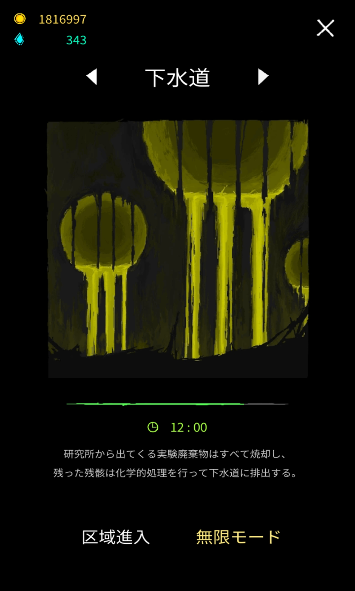

# 下水道

[実験室](laboratory.md) > 下水道(Sewerage) > [郊外](suburbs.md)

(郊外のページは後日作成します)

## ストーリー

### 序文

(和訳)研究の廃棄物は焼却されるか特定の熱過程の後下水道から放出される。様々な処理

(原文)The experiment are wastes incinerated or discharged through the sewerage after melting by the specific heat process. Various treatment

これの続きをご存知の方、コメント欄で教えてくださいm(\_ \_)m

### 不安定なマナの流れ(Unstable mana current(実際にはcurretn))

(和訳)燃焼マナは魔法を使う時に生成される。これは痕跡の一種で、魔法書を作ったり使った魔法の跡を辿るために使われる。周りに何も影響を与えず自然に消えることが多いが、小さなマナが過剰に生成された場合、空気を通して近くの物に吸収される。これにより知能の低い生物がマジックを部分的に真似ることができるようになるため、不測の惨事を引き起こしてしまう。

(原文)Combustion mana is generated when using magic. This is a kind of trace and it is used for producing magic scroll or tracking used magic. It tends to disappear naturally with any influence, but if the small mana were created excessively , it is absorbed into near matters through the air. That happening enables the low intelligent creatures to imitate the magic partially so that it leads to an expected disaster.

Journal、Progressより

解放条件 下水道を10分間以上一度生存

解放報酬 敵を80000体倒す

### 翻訳中
